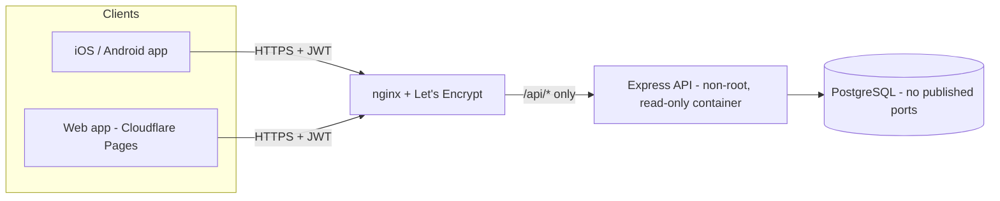

# MyMoney

[](https://github.com/Jump0ts/mymoney/actions/workflows/ci.yml)
[](./LICENSE)


A **personal-finance app** for iOS, Android and the web, built end to end as a solo project: expense and income tracking, categories, filters, charts and an **Excel-style monthly budget**. One TypeScript codebase for every client (React Native + Expo), a Node/Express/PostgreSQL API, automated tests, a CI pipeline and a hardened production deployment.

It is a personal tool, not a product: every account is **individual and private**, and no user can ever see another user's data.

## What this project demonstrates

| Area | What you will find in this repo |
|---|---|
| **Full-stack TypeScript** | React Native/Expo client and Express/Prisma API sharing conventions, strict typing, Zod validation on the server and Yup on forms. |
| **Product & domain design** | A monthly budget modelled as a recurring template plus per-month entries, group limits, a "whatever is left of my salary" group, refunds and drag-free reordering — designed from a real spreadsheet workflow. |
| **Testing** | 300+ client tests (Jest, React Native Testing Library) and 70+ API tests (Vitest + supertest against a real PostgreSQL), including tenant-isolation tests, plus shell tests for the deployment scripts. Features ship with their own tests. |
| **CI/CD** | GitHub Actions: lint, typecheck, build, tests with coverage, a job that builds and boots the production Docker image under the same restrictions as production, and `shellcheck`. |
| **Security** | Per-user data isolation, Helmet, JWT, rate limiting at the proxy, closed registration in production, secrets kept out of the repo, a strict Content Security Policy for the web build, supply-chain controls (pinned actions, image digests, provenance attestation). See [Security](#security). |
| **DevOps** | Docker (non-root, read-only, no capabilities), nginx + Let's Encrypt, GHCR, a forced-command SSH deploy key, automatic rollback, verified database backups that are restore-tested. |
| **Accessibility** | Screen-reader labels and announcements, large-text and reduce-motion support, AA contrast, touch targets, several audit-and-fix rounds. |
| **Engineering judgement** | Documented trade-offs and known limitations instead of pretending everything is perfect (see the deploy docs). |

## Features

- **Transactions** — income and expenses with categories; edit, delete, pagination; filters by type, category and month.
- **Overview** — monthly totals and charts (category donut and monthly bars) with a month picker.
- **Budget (spreadsheet style)**
  - Colour-coded groups (Home, Rent, Wants…) with lines that can be ticked as *paid*.
  - A **recurring template** that is copied into every new month, plus one-off lines for a single month.
  - Monthly salary, *total to spend* (planned vs. actual) and *remaining*.
  - An optional **limit per group** with a progress bar ("€X left" / "€X over").
  - A group that **receives whatever is left of the salary** (treats, surprises) and computes its own available amount.
  - Refunds as negative lines, and reordering of groups and lines.
- **Accessibility & theming** — light/dark mode, scalable text, reduced motion, screen-reader support.

## Tech stack

| Layer | Technology |
|---|---|
| Client | React Native, Expo (Expo Router), TypeScript, React Query, React Hook Form + Yup, Reanimated |
| API | Node.js, Express, Prisma ORM, PostgreSQL, Zod, JWT, Helmet |
| Testing | Jest + React Native Testing Library, Vitest + supertest (real PostgreSQL), shell tests with a mocked `docker` |
| CI/CD | GitHub Actions, Docker, GHCR |
| Deployment target | DigitalOcean (API + PostgreSQL behind nginx/Let's Encrypt), Cloudflare Pages (web), Cloudflare DNS |

## Architecture



The code is organised **by domain** (`transactions`, `categories`, `budgets`, `auth`), not by technical layer. Each domain owns its routes, validation schemas and types on the server, and its types, schemas, hooks and components on the client. Anything shared by two domains lives in the domain that owns the concept, never duplicated.

```
apps/mobile/   Expo app (iOS, Android, web)
backend/       Node.js + Prisma + PostgreSQL API
deploy/        Deployment (home server and VPS), backups and their documentation
```

## Notable design decisions

- **Tenant isolation as an invariant.** Every query is scoped to the authenticated user, and tests assert that one user cannot read or modify another's data (including the budget endpoints).
- **Lazily generated, idempotent months.** Opening a month creates it from the recurring template and the previous salary; concurrent requests are tolerated and months before the first budget are never back-filled with today's template.
- **Predictable money handling.** Amounts are stored as fixed-precision decimals and totals are rounded to cents in one place.
- **Optimistic UI with rollback.** Ticking a line as paid or reordering is instant on screen and is undone with a notice if the server refuses it.
- **Safe two-step operations.** Changes that touch both the template and the current month are retryable: a missing item counts as already done, so a half-failed request can be finished.
- **Accessible by construction.** Reordering uses buttons instead of drag gestures so it works with a keyboard and a screen reader, and moves are announced.

## Security

The production setup is designed, documented and covered by automated tests (it is being rolled out for the first release); the full threat model and trade-offs are in [`deploy/vps/README.md`](./deploy/vps/README.md) (in Spanish).

- Secrets are generated on the server and never stored in the repo; `.gitignore` blocks `.env.*`, keys and database dumps.
- The database publishes no ports and lives on a network with no Internet access; only `/api/*` and `/health` are reachable, everything else is a 404.
- The API container runs as non-root with a read-only filesystem and no Linux capabilities.
- Deployments are manual, pinned to an image **digest**, and the build's provenance attestation is verified before anything is deployed.
- The CI deploy key has a forced command: it can only ask for `deploy <digest> <user>`; no shell, no tunnels, no file copy.
- nginx changes are validated with `nginx -t` and rolled back on failure, so a bad config cannot take down the other site sharing the server.
- Brute-force protection on the auth endpoints, strict CORS, and public registration switched off in production.
- The web build ships a strict Content Security Policy (no inline or `eval` scripts; it can only talk to its own API).
- Backups are private (`umask 077`), taken before every migration, copied off the server with SHA-256 verification, and exercised by a restore test.

## Run it locally

Requirements: Node 24 (see `.nvmrc`) and PostgreSQL.

```bash
npm ci

# API
cp backend/.env.example backend/.env       # set DATABASE_URL and JWT_SECRET
npm run prisma:deploy --workspace=backend  # apply migrations
npm run prisma:seed --workspace=backend    # optional demo user: demo@mymoney.local / demo12345
npm run backend:dev                        # http://localhost:4000

# App (web, iOS or Android through Expo)
npm run mobile:dev                         # web uses EXPO_PUBLIC_API_URL (default http://localhost:4000)
```

> **Heads-up on the API tests:** they empty the tables of the database in `DATABASE_URL`. Use a different database from your development one (for example `mymoney_test`).

```bash
npm run test --workspace=backend
npm run test --workspace=apps/mobile
npm run lint --workspace=backend && npm run lint --workspace=apps/mobile
```

## Status and roadmap

**Beta.** The core features are complete and tested. Not built yet: automatic payment detection (Android), multiple accounts/wallets, and recurring expenses outside the budget.

## Documentation

Project conventions and workflow are in [CLAUDE.md](./CLAUDE.md); deployment, backups and the security model are in [`deploy/`](./deploy) (Spanish).

## License

[MIT](./LICENSE) © 2026 Jose Antonio Fernández Salado
