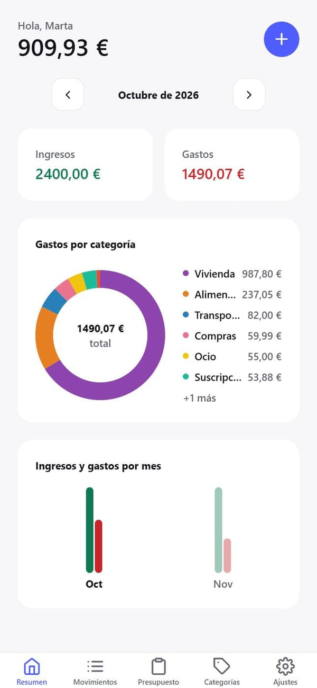
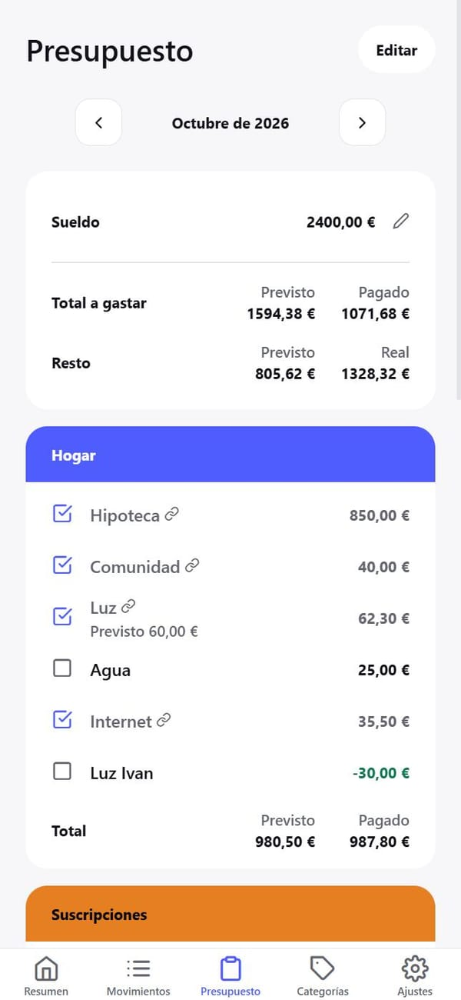
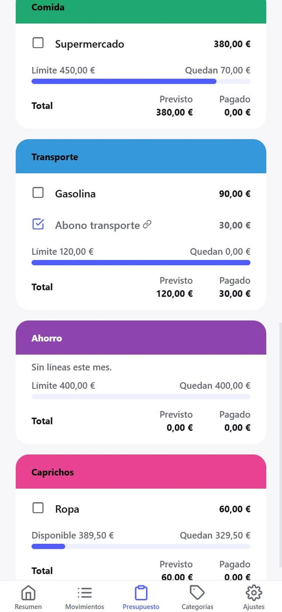
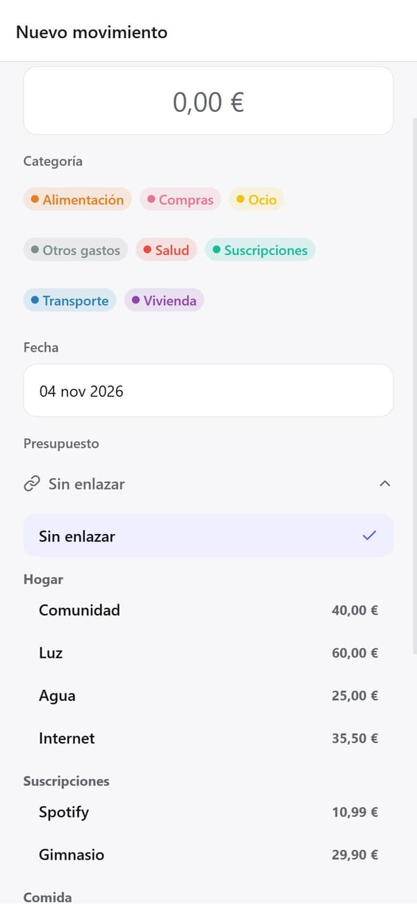
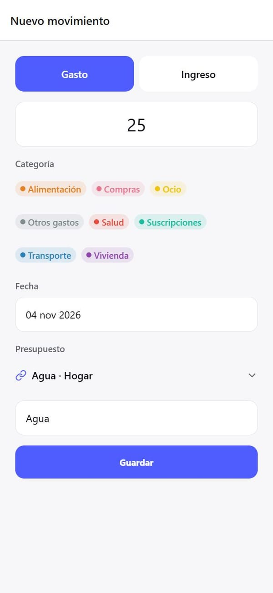
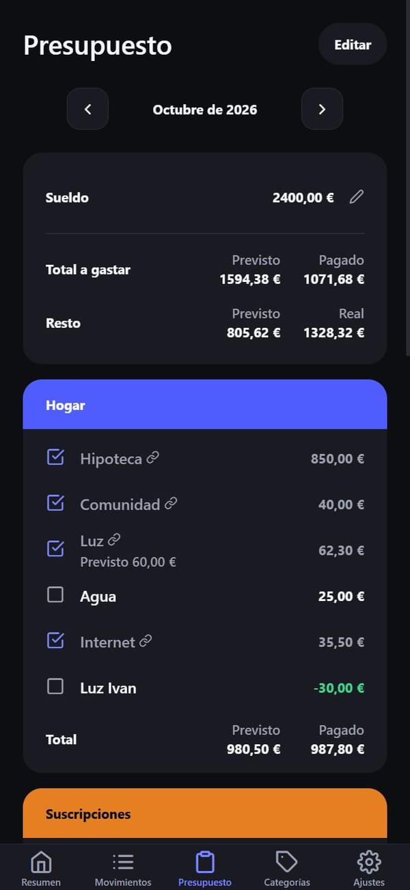
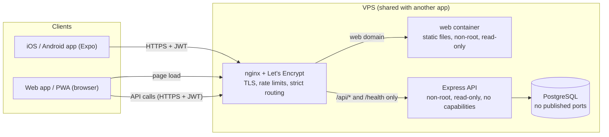
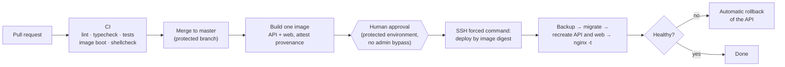

# MyMoney

[](https://github.com/Jump0ts/mymoney/actions/workflows/ci.yml)
[](./LICENSE)


**A personal-finance app built end to end by one developer: React Native + Expo client, Node/Express/PostgreSQL API, automated tests, CI/CD and a hardened production deployment.**

Track income and expenses, see where the money goes, and plan the month in an **Excel-style budget** with recurring lines, group limits and a "whatever is left of my salary" group. It runs in production on a small VPS, serves the web app from the same server, and ships through a pipeline that needs a human approval before anything is deployed.

> **Status: public beta (0.4.0).** The core product is feature-complete, covered by automated tests and running in production. It is a personal tool, not a product: every account is **individual and private**, registration is closed in production, and there is no public demo (see [Run it locally](#run-it-locally) for a seeded demo user). It is not a 1.0: expect rough edges. See the [changelog](./CHANGELOG.md).

## Screenshots

The app's interface is in Spanish (it is the author's native language and the only locale so far). Captured from a running build with sample data.

| Overview | Monthly budget | Group limits and the "remainder" group |
|:---:|:---:|:---:|
|  |  |  |

| Link an expense to a budget line | The line is picked and the form fills itself | Dark theme |
|:---:|:---:|:---:|
|  |  |  |

## What this project demonstrates

| Area | What you will find in this repo |
|---|---|
| **Full-stack TypeScript** | React Native/Expo client and Express/Prisma API sharing conventions and strict typing; Zod validation on the server, Yup on the forms. One codebase for iOS, Android and web. |
| **Product & domain design** | A monthly budget modelled as a recurring template plus per-month entries, group limits that reserve money, a group that receives what is left of the salary, refunds, and expenses that can be linked to budget lines — designed from a real spreadsheet workflow. |
| **Testing** | 500+ client tests (Jest, React Native Testing Library), 190+ API tests (Vitest + supertest against a real PostgreSQL, including tenant-isolation and concurrency tests), and shell tests for the deployment scripts. Every change ships with its own tests. |
| **CI/CD** | GitHub Actions: lint, typecheck, build, tests with coverage, a job that **builds the production Docker image and boots it under the same restrictions as production** (including the web server), and `shellcheck`. Deployments are automatic but gated by a human approval. |
| **Security** | Per-user data isolation, JWT, Helmet, rate limiting at the proxy, closed registration, a strict Content Security Policy, secret scanning and push protection, supply-chain controls (pinned actions, image digests, provenance attestation). See [Security](#security). |
| **DevOps** | Docker (non-root, read-only, no capabilities), nginx + Let's Encrypt on a server shared with another app, GHCR, a forced-command SSH deploy key, automatic rollback of the API, daily database backups that are restore-tested. |
| **Accessibility** | Screen-reader labels and announcements, large-text and reduce-motion support, AA contrast, 44 pt touch targets, several audit-and-fix rounds. |
| **Engineering judgement** | Documented trade-offs, a [changelog](./CHANGELOG.md) with the *why* of each release, and known limitations written down instead of hidden (see the [deployment docs](./deploy/vps/README.md)). |

## Features

- **Transactions** — income and expenses with categories; create, edit, delete and paginate; filters by type, category, month and day; search.
- **Overview** — monthly totals, a category donut chart and monthly bars, with a month picker.
- **Budget (spreadsheet style)**
  - Colour-coded groups (Home, Subscriptions, Food…) with lines you tick as *paid*.
  - A **recurring template** that is copied into every new month, plus one-off lines for a single month.
  - Monthly salary, *total to spend* (planned vs. real) and *remaining*.
  - An optional **limit per group** with a progress bar ("€X left" / "€X over").
  - A group that **receives whatever is left of the salary** (treats, surprises): its available amount is the salary minus what every other group has set aside — the limit of a group, or what its lines add up to if that is more.
  - Refunds as negative lines, and reordering of groups and lines with accessible up/down buttons.
- **Link an expense to a budget line** — when you add an expense, pick the line it pays. The line is marked as paid with the **real amount** (the planned one stays visible underneath), and the amount and description are filled from the line if you left them empty. One expense per line.
- **Installable web app (PWA)** — the web build can be added to the home screen with its own icon and runs full screen, with light/dark system-bar colours and safe-area support.
- **Accessibility & theming** — light/dark mode, scalable text, reduced motion, screen-reader support.

## Tech stack

| Layer | Technology |
|---|---|
| Client | React Native 0.86, Expo SDK 57 (Expo Router), TypeScript, React Query, React Hook Form + Yup, Reanimated |
| API | Node.js 24, Express, Prisma ORM, PostgreSQL 16, Zod, JWT, Helmet |
| Testing | Jest + React Native Testing Library, Vitest + supertest (real PostgreSQL), shell tests with a mocked `docker` |
| CI/CD | GitHub Actions, Docker (multi-stage), GHCR, build provenance attestation |
| Hosting | One DigitalOcean VPS shared with another app: nginx + Let's Encrypt in front of the API, a static-web container and PostgreSQL; Cloudflare for DNS |

## Architecture



The code is organised **by domain** (`transactions`, `categories`, `budgets`, `auth`), not by technical layer. Each domain owns its routes, validation schemas and types on the server, and its types, schemas, hooks and components on the client. Anything shared by two domains lives in the domain that owns the concept, never duplicated.

```
apps/mobile/   Expo app (iOS, Android, web)
backend/       Node.js + Prisma + PostgreSQL API
deploy/        Deployment (VPS and home server), backups and their documentation
docs/          Screenshots used by this README
```

### Delivery pipeline



Branches follow a documented flow (`feature/*` → `pre` → `release/x.y.z` → `master`, with `hotfix/*` for urgent fixes), and nothing is pushed to a protected branch directly.

## Notable design decisions

- **Tenant isolation as an invariant.** Every query is scoped to the authenticated user, and tests assert that one user cannot read or modify another's data — including when linking an expense to a budget line that belongs to someone else.
- **Lazily generated, idempotent months.** Opening a month creates it from the recurring template and the previous salary; concurrent requests are tolerated and months before the first budget are never back-filled with today's template.
- **Linking enforced where it cannot be bypassed.** A normal budget line takes one expense and an *envelope* (a variable line such as groceries) takes as many as you like. Because no unique index can express "one, unless the line is an envelope", linking locks the line's row (`SELECT … FOR UPDATE`) inside the transaction, so two simultaneous requests are served one after the other and the second one gets a `409` (a test fires them in parallel and fails if the lock is removed). Linking, unlinking, deleting and changing the type of an expense update the line's *paid* state in the same database transaction.
- **Predictable money handling.** Amounts are stored as fixed-precision decimals and totals are rounded to cents in one place.
- **Optimistic UI with rollback.** Ticking a line as paid or reordering is instant on screen and is undone with a notice if the server refuses it.
- **Safe two-step operations.** Changes that touch both the template and the current month are retryable: a missing item counts as already done, so a half-failed request can be finished.
- **Accessible by construction.** Reordering uses buttons instead of drag gestures so it works with a keyboard and a screen reader, and moves are announced.
- **One artifact, one approval.** The API image also carries the compiled web app and the config of its own nginx container, so a single digest and a single approval deploy both at the same version. The web is served from the same VPS on purpose: shared CDN addresses are blocked by Spanish ISPs during some football matches, while the server's own address is not.
- **Boring where it matters.** The installable web app has no service worker (no cache surprises); dependency majors that touch validation or forms are done deliberately, not by a bot.

## Security

The production setup is designed, documented, covered by automated tests and running; the full threat model and trade-offs are in [`deploy/vps/README.md`](./deploy/vps/README.md).

- Secrets are generated on the server and never stored in the repo; `.gitignore` blocks `.env.*`, keys and database dumps, and GitHub secret scanning with push protection is on.
- The database publishes no ports and lives on a network with no Internet access; only `/api/*` and `/health` are reachable on the API, everything else is a 404.
- The API and web containers run as non-root with a read-only filesystem and no Linux capabilities.
- Deployments are automatic on every relevant push to `master` but **wait for a human approval** (protected `production` environment, no admin bypass), are pinned to an image **digest**, and the build's provenance attestation is verified before anything is deployed. `master` only accepts pull requests with passing CI.
- The CI deploy key has a forced command: it can only ask for `deploy <digest> <user>`; no shell, no tunnels, no file copy.
- nginx changes are validated with `nginx -t` and rolled back on failure, so a bad config cannot take down the other site sharing the server.
- Brute-force protection on the auth endpoints, strict CORS, and public registration switched off in production.
- The web build ships a strict Content Security Policy (no inline or `eval` scripts; it can only talk to its own API), and every security header is sent exactly once.
- Backups are private (`umask 077`), taken daily and before every migration, with a script that pulls SHA-256-verified copies off the server, and exercised by a restore test.
- Dependabot alerts are triaged openly: what reaches production gets fixed; dev-only tooling is upgraded in dedicated pull requests.

## Run it locally

Requirements: Node 24 (see `.nvmrc`) and PostgreSQL.

```bash
npm ci

# API
cp backend/.env.example backend/.env       # set DATABASE_URL, TEST_DATABASE_URL and JWT_SECRET
npm run prisma:deploy --workspace=backend  # apply migrations
npm run prisma:seed --workspace=backend    # optional demo user: demo@mymoney.local / demo12345
npm run backend:dev                        # http://localhost:4000

# App (web, iOS or Android through Expo)
npm run mobile:dev                         # web uses EXPO_PUBLIC_API_URL (default http://localhost:4000)
```

> **API tests and your data:** the API tests empty every table before each test, so they run against `TEST_DATABASE_URL`, a database separate from your development one (`DATABASE_URL`). A guard refuses to run them unless the database name ends in `_test`, so they cannot wipe a development or production database by mistake. Apply the migrations to the test database too.

```bash
npm run test --workspace=backend
npm run test --workspace=apps/mobile
npm run lint --workspace=backend && npm run lint --workspace=apps/mobile
```

## Status and roadmap

**Beta (v0.4.0).** The core features are complete and tested; the [changelog](./CHANGELOG.md) lists what each release contains. The web app is live and installable; native iOS and Android builds run in Expo Go (store builds are not published yet). Not built yet: an installable Android APK, automatic payment detection (Android) and multiple accounts/wallets.

## Documentation

Project conventions and workflow are in [CLAUDE.md](./CLAUDE.md) (in Spanish, like the source comments); the deployment runbook and the security model are in [`deploy/vps/README.md`](./deploy/vps/README.md) (English); the older backup and home-server guides in [`deploy/`](./deploy) are in Spanish.

## Author

**Jose Antonio Fernández Salado** — designed, built, tested and operates MyMoney end to end.

I am open to new opportunities. You can reach me here:

- LinkedIn: [linkedin.com/in/josanfersal](https://www.linkedin.com/in/josanfersal/)
- GitHub: [@Jump0ts](https://github.com/Jump0ts)
- Email: josanfersal@gmail.com

## License

[MIT](./LICENSE) © 2026 Jose Antonio Fernández Salado
